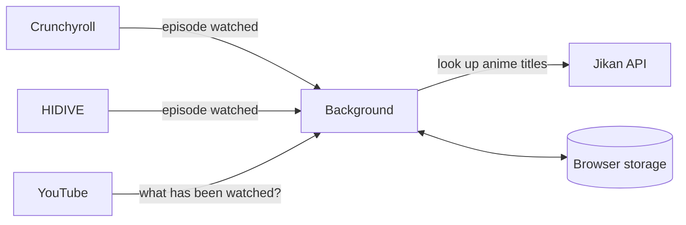

# Architecture

The extension does two things:

1. **Records what you watch** on Crunchyroll and HIDIVE.
2. **Hides YouTube videos** about episodes you haven't watched yet.

## Recording what you watch

While you watch an episode, the extension reads the series, season and episode from the
page and saves the latest one per series as your **watch history**.

- **Crunchyroll:** one episode page is enough.
- **HIDIVE:** the season page tells the extension which series and season it is, and
  only an episode page updates the watch history.

The first time a series is seen, the extension looks up all its names on Jikan.

## Jikan API

[Jikan](https://jikan.moe/) is a free, unofficial API for
[MyAnimeList](https://myanimelist.net/) data. The extension uses it to collect every
name of a series, for example "Oshi No Ko", "[Oshi no Ko]" and "【推しの子】", so that
YouTube videos match in any language. Only the series title is sent to Jikan.

## Hiding spoilers on YouTube

1. While YouTube loads, video cards stay hidden until the watch history is loaded.
2. Each video title is checked for a series name and a season or episode number.
3. A video is blurred when it's about a later season or episode than you've watched, or
   when it names the series without any number (e.g. "SEASON FINALE").
4. New videos are checked as they appear, and changes to the watch history apply
   without reloading the page.

Series that aren't in the watch history are never blocked.

## Where data is stored

| Data           | Example                                |
| -------------- | -------------------------------------- |
| Watch history  | Oshi No Ko: season 2, episode 13       |
| HIDIVE seasons | Season ID 24567 is Oshi No Ko season 2 |
| Series names   | Oshi No Ko, [Oshi no Ko], 【推しの子】 |

Everything is stored in the browser. The watch history and HIDIVE seasons use the
browser's sync storage, so they're shared across your devices if browser sync is on.
You can view and edit all of it on the extension's options page.

## Code map

| Path                                              | What it does                                                      |
| ------------------------------------------------- | ----------------------------------------------------------------- |
| `src/contents/crunchyroll`, `src/contents/hidive` | Read episodes from streaming pages                                |
| `src/contents/youtube`                            | Hide spoilers on YouTube                                          |
| `src/background`                                  | Save the watch history and serve it to YouTube                    |
| `src/blocker`                                     | Decide whether a title is a spoiler, and update the watch history |
| `src/jikan`                                       | Jikan API client                                                  |
| `src/options`, `src/popup`                        | Settings page and toolbar popup                                   |
